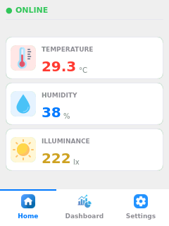
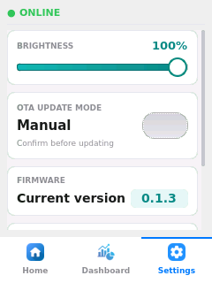
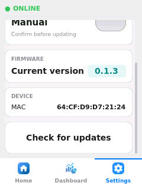
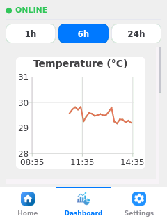
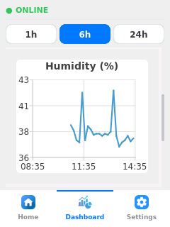
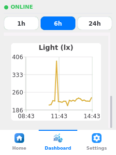
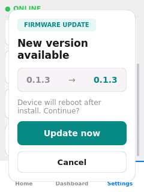
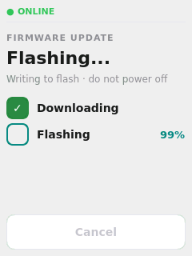
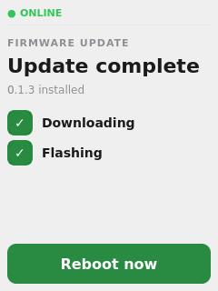

# sensornode-ui

Ứng dụng HMI Qt5 cho [SensorNode-BBB](https://github.com/Leminuos/SensorNode-BBB) - sensor node Embedded Linux trên BeagleBone Black.

## Overview

Ứng dụng Qt5 chạy fullscreen trên màn hình TFT 240×320 của BBB. Vai trò:
- Hiển thị số liệu nhiệt độ / độ ẩm / ánh sáng và biểu đồ lịch sử.
- Chỉnh độ sáng màn hình (PWM) và cập nhật firmware OTA ngay trên UI.

UI là client thuần của [sensornode-core](https://github.com/Leminuos/sensornode-core): đọc cảm biến, lưu SQLite, MQTT và cài firmware đều do hai daemon của core làm.

| Daemon                  | UI dùng                                                         |
|-------------------------|-----------------------------------------------------------------|
| `sensornode-telemetryd` | `/run/sensornode/telemetry.sock` (sample live), `/var/lib/sensornode/telemetry.db` (lịch sử, read-only) |
| `sensornode-otad`       | `/run/sensornode/ota.sock` (trạng thái OTA, lệnh install/reboot) |

## Giao diện

Các ảnh dưới đây được chụp trực tiếp từ framebuffer của board.

### Màn hình Home

Dashboard nhiệt độ / độ ẩm / ánh sáng đọc từ cảm biến, kèm trạng thái online.



### Màn hình Settings

Chỉnh độ sáng, chế độ OTA, version hiện tại, thông tin thiết bị (MAC) và nút *Check for updates*.

| Cài đặt | Cài đặt |
|:---:|:---:|
|  |  |

### Dashboard biểu đồ

Biểu đồ lịch sử số liệu cảm biến, chọn khoảng thời gian 1h / 6h / 24h.

| Temperature | Humidity | Light |
|:---:|:---:|:---:|
|  |  |  |

### Luồng cập nhật OTA

| Phát hiện bản mới | Đang cài | Hoàn tất |
|:---:|:---:|:---:|
|  |  |  |
| Popup hiện khi có version mới | Tiến độ download → flash | Cài xong, hiện nút *Reboot now* |

## Cấu trúc

```
sensornode-ui/
├── CMakeLists.txt
├── tools/deploy.sh             # cross-build + inject binary lên board qua SSH
├── docs/                       # hướng dẫn phát triển UI (screen, shared widget, tag .ui)
├── tests/                      # Qt Test chạy trên host, daemon giả qua QLocalServer
├── src/
│   ├── main.cpp                # entrypoint: QApplication + Theme + AppWindow
│   ├── app/
│   │   ├── AppWindow.*         # sở hữu model + UI, nơi duy nhất nối các thành phần
│   │   └── Theme.*             # gộp các file QSS thành stylesheet của app
│   ├── ipc/
│   │   ├── DaemonClient.*      # client JSON Lines qua QLocalSocket, tự kết nối lại
│   │   └── DaemonEndpoints.h   # socket / DB của sensornode-core (override qua env)
│   ├── model/                  # QObject, không có QWidget
│   │   ├── Sample.h            # một mẫu số liệu (timestamp, °C, %, lx; NaN = cảm biến lỗi)
│   │   ├── TelemetryModel.*    # client telemetryd, phát sampleReceived
│   │   ├── HistoryModel.*      # đọc lịch sử từ SQLite read-only, gom theo bucket
│   │   ├── OtaModel.*          # client otad + popup / manual check / chế độ auto
│   │   └── OtaState.h          # enum trạng thái luồng OTA phía UI
│   ├── screens/                # view thuần: nhận dữ liệu qua slot, phát ý định qua signal
│   │   ├── HomeScreen.*        # tab Home — nhiệt độ / độ ẩm / ánh sáng
│   │   ├── ChartScreen.*       # tab Dashboard — 3 chart Qt Charts (1h/6h/24h)
│   │   ├── SettingsScreen.*    # backlight + chế độ OTA + version
│   │   ├── UpdatePopup.*       # popup version mới
│   │   └── UpdateProgressScreen.*  # màn tiến độ update (download -> flash -> done)
│   ├── widgets/                # shared widget
│   │   ├── BottomNavBar.*      # nav bar Home/Dashboard/Settings
│   │   └── StatusHeader.*      # chỉ báo online/offline
│   ├── drivers/
│   │   └── BacklightPwm.*      # backlight qua sysfs PWM
│   ├── network/
│   │   └── NetworkInfo.*       # đọc MAC address
│   └── settings/
│       ├── AppSettings.*       # cấu hình UI (độ sáng) ở /data/config/setting.json
│       └── OtaSettings.*       # chế độ OTA auto/manual ở /data/config/ota.json
└── resources/                  # resources.qrc — icons + QSS stylesheet
```

### Luồng dữ liệu

`AppWindow` là nơi duy nhất nối các thành phần; screen không biết về screen khác và không tự mở socket, file hay I2C.

```
telemetry.sock  → TelemetryModel::sampleReceived → HomeScreen::setValues → ChartScreen::reload → HistoryModel::range (SQLite)
                  TelemetryModel::onlineChanged  → StatusHeader::setOnlineStatus
ota.sock        → OtaModel::stateChanged         → AppWindow::onOtaStateChanged → popup / UpdateProgressScreen
                  OtaModel::progressChanged      → UpdateProgressScreen::setProgress
UpdatePopup / UpdateProgressScreen → OtaModel::confirmUpdate / reboot → lệnh install / reboot
```

Chart chỉ đọc lại DB khi tab Dashboard đang hiển thị.

### OTA

- Chế độ **auto**: có `available` mới là bật popup. **Manual**: chỉ báo khi bấm *Check for updates*.
- *Update now* gửi `install` không kèm url, otad cài bản `available` nó đang giữ.
- otad không hỗ trợ huỷ giữa chừng nên nút *Cancel* bị khoá cả lúc download.
- Khi đang boot thử bản mới, nút *Update now* bị khoá và status header hiện `VERIFYING UPDATE`. `OtaModel` hỏi lại `status` mỗi 3 giây tới khi `ota-confirm-boot` commit.
- UI khởi động lại giữa lúc đang cài thì hiện tiếp màn tiến độ. Trạng thái `failed` còn sót từ lần trước thì bỏ qua.

## Yêu cầu build

- Qt 5.15: `Widgets`, `Network`, `Charts`
- `sqlite3`
- CMake ≥ 3.16, `pkg-config`, compiler C++17
