# Thiết kế giao diện

## Phong cách

Phong cách đã chốt là **Cloud**: nền sáng, thẻ trắng đổ bóng mềm, nút xanh dương, số liệu là nhân vật chính.

- Bề mặt nổi có gradient nhẹ, bóng mềm và viền sáng 1 px ở mép trên.
- Nút nổi khi thường, lún và mất bóng khi nhấn, phẳng khi khoá.
- Mỗi đại lượng có màu riêng: nhiệt độ đỏ, độ ẩm xanh dương, ánh sáng vàng cam.
- Bo góc lớn, khoảng trống rộng, ít chữ.

## Thành phần dùng chung

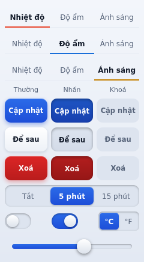

| Widget | Vai trò |
|---|---|
| `StatusHeader` | Status bar: giờ, chip kiểm tra hệ thống, icon mạng |
| `BottomNavBar` | Thanh tab Tổng quan / Biểu đồ / Cài đặt |
| `SubPage` | Khung trang con: thanh tiêu đề có nút quay lại, nội dung 240×256 |
| `MetricTile` | Thẻ màu đại lượng, có đồ thị vùng tràn sát mép |
| `ListCard`, `ListRow` | Thẻ danh sách dòng 44 px, ô icon màu bên trái, chevron hoặc giá trị bên phải |
| `KeyValueList` | Thẻ cặp nhãn / giá trị chỉ đọc, giá trị dài bị cắt bằng dấu ba chấm |
| `ScrollList` | Danh sách cuộn, dùng khi không vừa một trang như danh sách vị trí |
| `RaisedButton` | Nút `primary`, `secondary`, `danger` với ba trạng thái |
| `SegmentedControl` | Chọn một trong vài giá trị, cao 36 px |
| `MiniSegment` | Segment nhỏ nằm trong dòng, ví dụ °C/°F |
| `TouchSlider` | Slider có núm 24 px, dễ kéo bằng cảm ứng điện trở |
| `BottomSheet` | Hộp xác nhận trượt từ dưới lên, có nền tối phía trên |
| `ProgressRing` | Vòng tiến độ OTA |
| `StepBar` | Thanh bước Tải về / Cài đặt / Khởi động / Kiểm tra |

Ô icon trong `ListRow` có các màu `default`, `yellow`, `aqua`, `red`, `blue`, `green`. Màu chỉ để nhận ra dòng nhanh, không mang nghĩa trạng thái, trừ đỏ dùng cho thao tác nguy hiểm.

## Danh mục màn hình

```
S1 Tổng quan
S2 Biểu đồ
S3 Cài đặt
├── S3a Màn hình
├── S3b Chu kỳ lấy mẫu
├── Đơn vị nhiệt độ: chỉnh ngay trên dòng
├── S3c Ngôn ngữ & vị trí
│   └── S3e Vị trí
├── S3d Cập nhật firmware
└── S4 Bảo trì
    ├── S4b Thiết bị
    ├── S4j Hệ thống → S4f xác nhận khởi động lại
    ├── S4e Mạng → S4e1 Ethernet, S4e2 Wi-Fi
    ├── S4i Nâng cao (chỉ bản dev)
    │   ├── S4a Firmware & khởi động
    │   ├── S4c Cảm biến
    │   ├── S5a → S5b → S5c Hiệu chỉnh cảm ứng
    │   └── S4d Nhật ký lỗi
    └── S4h Khôi phục cài đặt gốc
S6 Luồng OTA, hiện đè lên mọi trang
```

### Khởi động

| S0b Đang khởi động | S0b Gần xong |
|:---:|:---:|
| 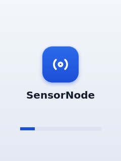 | 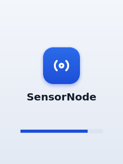 |

### Ba tab chính

| Tổng quan | Khi lỗi cảm biến | Biểu đồ | Cài đặt |
|:---:|:---:|:---:|:---:|
| 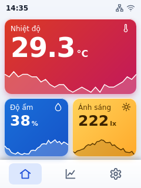 | 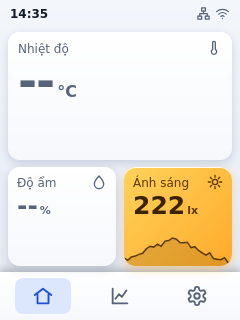 | 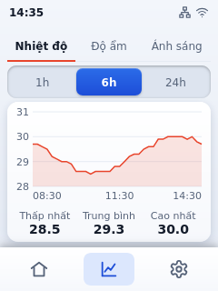 | 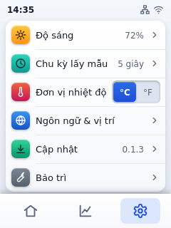 |

### Cài đặt

| Độ sáng | Chu kỳ lấy mẫu | Ngôn ngữ & vị trí |
|:---:|:---:|:---:|
| 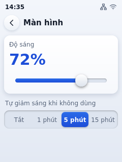 | 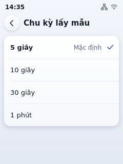 | 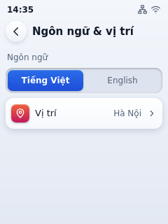 |

| Ngôn ngữ & Vị trí | Cập nhật | Bảo trì |
|:---:|:---:|:---:|
| 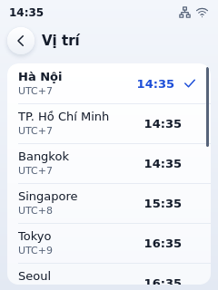 | 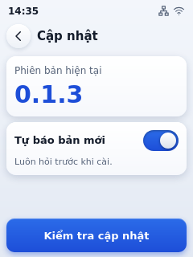 | 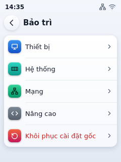 |

### Bảo trì

| Thiết bị | Hệ thống | Khởi động lại | Khôi phục cài đặt gốc |
|:---:|:---:|:---:|:---:|
| 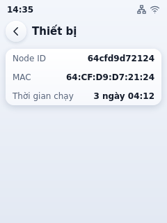 | 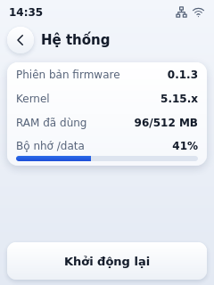 |  |  |

| Mạng | Ethernet chưa nối | Ethernet | Wi-Fi |
|:---:|:---:|:---:|:---:|
| 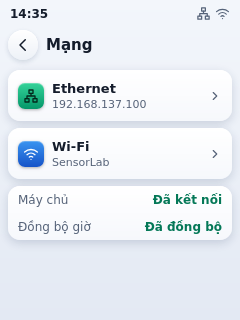 | 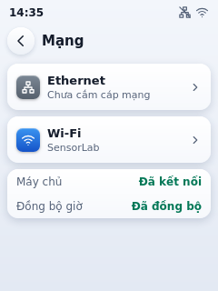 | 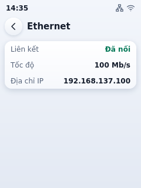 | 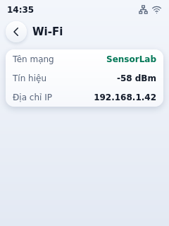 |

### Nâng cao (chỉ bản dev)

| Nâng cao | Firmware & khởi động | Cảm biến | Nhật ký lỗi |
|:---:|:---:|:---:|:---:|
| 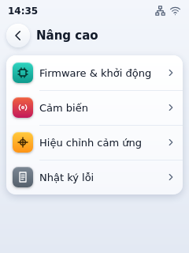 | 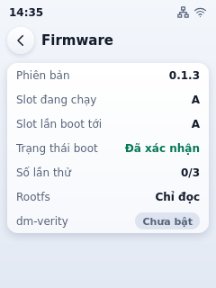 | 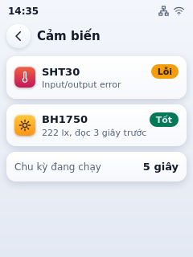 | 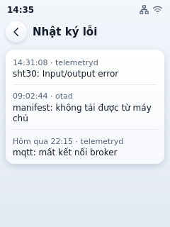 |

### Hiệu chỉnh cảm ứng

| S5a Giới thiệu | S5b Chạm điểm | S5c Kiểm tra |
|:---:|:---:|:---:|
| 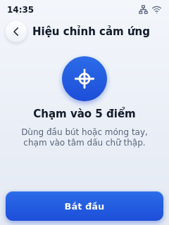 | 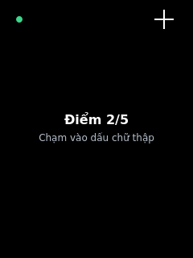 |  |

### Luồng OTA

Màn OTA dùng chế độ `Takeover`

| Có bản mới | Tải về | Cài đặt | Cài xong |
|:---:|:---:|:---:|:---:|
| 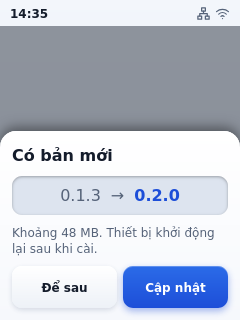 | 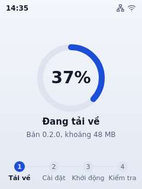 | 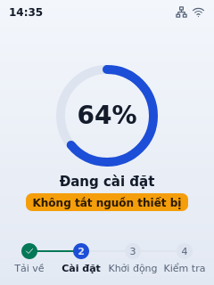 | 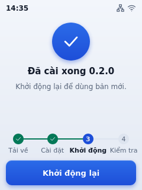 |

| Đang khởi động lại | Kiểm tra sau update |
|:---:|:---:|
| 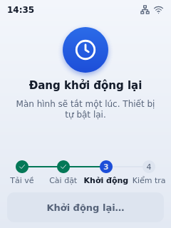 | 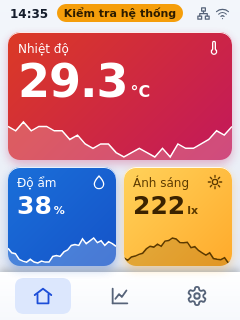 |

Khi có lỗi, thanh bước gạch chéo đúng bước hỏng:

| Lỗi khi tải về | Lỗi khi cài đặt | Backup |
|:---:|:---:|:---:|
| 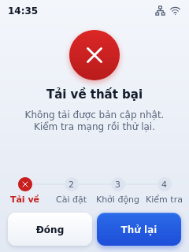 | 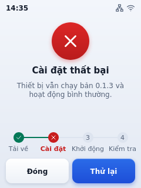 | 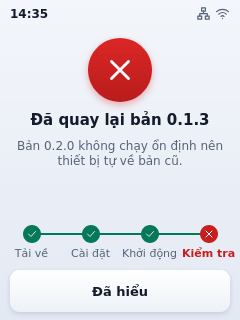 |

